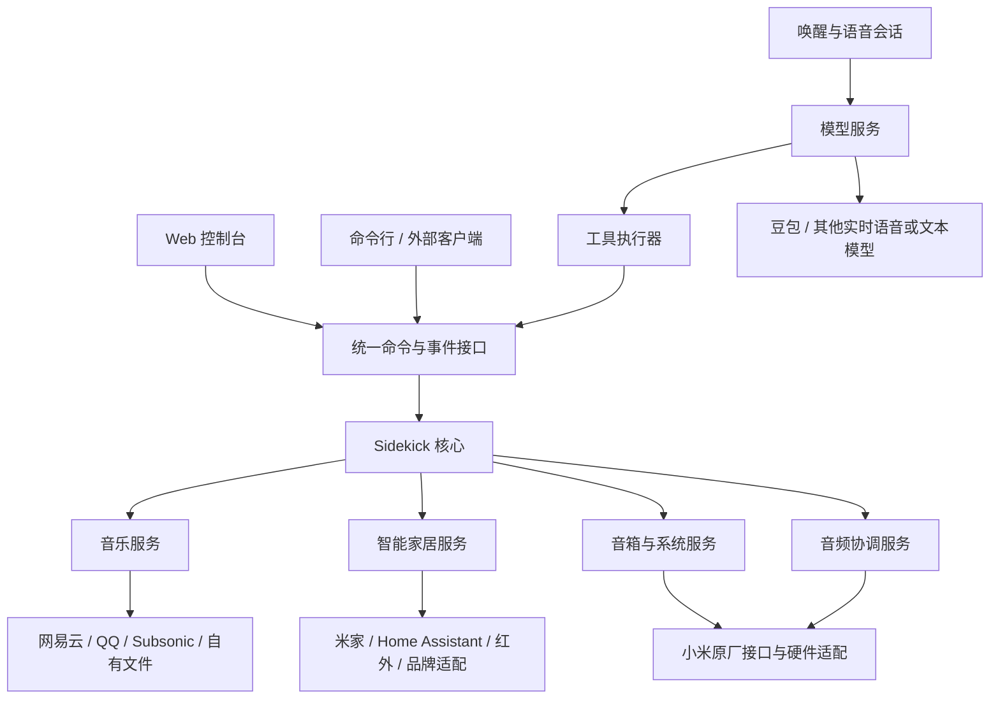

# Reference: XiaoAI Sidekick：完整 Zig 迁移与可持续 AI 迭代架构设计

状态：架构设计稿，尚未实施完整迁移。

本文件记录已经讨论的目标架构、模块边界、目录结构、协议、测试和迁移顺序。目标目录中的模块与命令不代表当前仓库已经具备对应实现。现有功能是否可用，以主线程的源码、实机记录和报告为准。

## 1. 定位与决策

XiaoAI Sidekick 是以 Zig 为核心的音箱运行平台。它以 Sidecar 方式与原厂服务共存，在保留小爱及原有设备功能的目标下，扩展模型对话、聚合音乐和智能家居控制。

长期扩展方向：

- 模型不绑定豆包，可增加其他实时语音模型和文本模型。
- 音乐不绑定网易云，可增加 QQ、Navidrome/OpenSubsonic、自有文件等来源。
- 智能家居不绑定米家，可增加 Home Assistant、红外和经验证的品牌接口。
- 优先在音箱内完成；资源不足时，允许将同一适配器接口对应的服务放到 NAS。

完整迁移的范围：

- 自有机内服务、业务逻辑、协议、工具和适配器统一迁移为 Zig。
- 浏览器页面继续使用 HTML、CSS 和 JavaScript。
- 原厂动态库与必要的第三方库作为依赖保留，不重新实现 TLS、密码学和成熟音频解码器。
- 必要的 Shell/PowerShell 只作为很薄的部署或开发包装层。
- 固定 Zig 工具链版本，升级工具链作为独立变更验证。

迁移的主要收益是清楚的模块契约、统一资源生命周期和可控内存；性能与体积是否改善必须实测，不能由语言名称推断。

## 2. 总体架构



主要边界：

| 类别 | 职责 | 示例 |
| --- | --- | --- |
| 核心机制 | 生命周期、状态、任务、事件、配置、资源限制 | core |
| 模型适配器 | 平台协议与统一会话事件之间的转换 | Doubao |
| 领域服务 | 管理用户要完成的业务和业务状态 | music、home、device |
| 音源/家居适配器 | 连接账号、曲库或外部设备生态 | NetEase、Home Assistant |
| 设备平台适配器 | 操作原厂接口与本机硬件 | 小米 ubus、ALSA、灯环 |
| 访问入口 | 命令提交、状态展示 | Web、CLI、语音工具 |

模型负责理解，领域服务管理业务，平台适配器执行设备操作。Web 页面与模型共用能力接口，不各自实现一套控制逻辑。

## 3. 核心服务

核心只实现通用机制：

- Lifecycle：初始化、启动、停止、故障恢复。
- Config：加载、校验、更新、版本迁移。
- StateStore：当前状态、最后可靠观测、更新时间。
- EventBus：有序事件发布与订阅。
- TaskManager：长任务、取消、超时、去重、结果查询。
- CapabilityRegistry：能力发现、参数契约、当前可用性。
- ResourceBudget：内存、连接、缓冲、并发和队列限制。
- CredentialStore：按引用读取凭据，支持安全保存与清除。

核心不包含网易云 API 地址、豆包原始事件名称、米家具体命令或灯效编号。

状态需要表达 unknown、stale、unavailable，不能把缺失数据视为正常。核心、业务和适配器应分别保留错误上下文，组合出可解释的结果。

## 4. 模型服务

### 4.1 两种模型能力

```text
TextModel
  输入：消息、上下文、工具定义
  输出：文字、工具调用、完成或错误

RealtimeVoiceModel
  输入：音频帧、会话配置、工具结果、取消信号
  输出：识别事件、文字、音频、工具调用、会话事件
```

端到端实时语音模型不强行拆成独立 ASR、LLM 和 TTS。需要支持其他组合时，另由会话协调器组合对应能力。

### 4.2 统一会话事件

```text
session.ready
speech.started
transcript.updated
response.text
response.audio
tool.requested
response.completed
session.closed
provider.failed
```

Provider 将自己的协议转换成统一事件，并声明：实时语音、文字输入、工具调用、取消、打断、识别文字及音频格式等能力。

模型替换不影响音乐、家居和 Web 的业务接口。跨模型会话接续可以依靠文字或摘要转换，不保证原始实时会话直接兼容。

## 5. 聚合音乐服务

### 5.1 分离业务、来源和播放器

MusicService 管理队列、上一首/下一首、播放模式、进度恢复、音源选择、失败处理，以及与语音播报之间的暂停和恢复。

MusicProvider 管理登录、会话刷新、搜索、歌单、收藏、账号权限和音源获取。

Renderer 管理音频流打开、解码输出、暂停/继续/定位，并报告实际播放状态。

音源适配器不操作灯环或 ALSA，不直接拥有全局播放队列。

### 5.2 歌曲与播放地址分开

```json
{
  "source": "netease",
  "id": "123456",
  "title": "歌曲名称",
  "artists": ["歌手"],
  "duration_ms": 240000
}
```

获取音源时返回 StreamLease：播放地址、必要请求头、编码、实际音质、预计有效期、试听标志和定位支持情况。地址不是永久歌曲身份。

聚合搜索保留来源和版本信息，不能仅凭歌名合并歌曲。每个平台的会员、地区、专辑和客户端权限独立判断。

用户已明确接受播放 URL 进入原厂日志，不为隐藏 URL 强制增加代理。账号密码、Cookie 和模型密钥不进入日志或模型上下文。

## 6. 家居服务

核心设备模型以设备、能力、状态和动作为基础，不以品牌名称作为通用命令。

```json
{
  "id": "homeassistant:light.living_room",
  "name": "客厅灯",
  "room": "客厅",
  "capabilities": ["switch", "brightness", "color_temperature"]
}
```

```json
{
  "device_id": "homeassistant:light.living_room",
  "capability": "brightness",
  "operation": "set",
  "value": 60
}
```

适配器规划：

| 适配器 | 用途 |
| --- | --- |
| xiaomi | 恢复并对接小米原有设备控制路径 |
| home_assistant | 接入 HA 已有设备、实体和场景 |
| infrared | 将已配置遥控器映射为设备能力 |
| 品牌直接适配 | 在明确型号和可验证接口后实现 |

TCL 是品牌，不是一种统一协议。具体设备先按已验证的 Home Assistant 集成、红外映射或直接接口接入，不提前承诺一个适配器覆盖所有型号。

重复发现的同一设备需要明确别名与关联，避免重复执行。

执行结果分为：命令已发送、平台已接受、设备状态已确认、无法读取结果、执行失败。红外发码成功不等于设备状态已确认。

## 7. 音频与灯效协调

AudioCoordinator 统一管理录音/播放资源、音乐与语音优先级、暂停/恢复/取消，以及原厂音频服务共存。

IndicatorController 根据语义状态选择效果，记录所有者并释放过期状态，再由具体型号映射到硬件。

```text
idle / listening / connecting / thinking
speaking / waiting_followup / error
```

业务模块不直接调用原厂灯效命令。

资源租约示例：

```text
所有者：voice-session-42
资源：音频播放、会话灯效
释放：正常结束、取消、超时、进程退出
```

原厂小爱属于外部进程，仍需平台层观察与仲裁。统一协调器为处理共存提供机制，不代表共存问题自动解决。

## 8. 协议设计

### 8.1 对外与内部

- HTTP：查询状态、提交命令、查询任务。
- SSE：状态与事件推送。
- Unix Socket：后续需要跨进程时使用。
- JSON：外部命令、结果与事件格式。
- Zig 结构体、枚举、tagged union：进程内部直接传递，不反复 JSON 编解码。

### 8.2 命令、结果、事件

```json
{
  "version": 1,
  "id": "request-001",
  "method": "music.play",
  "params": {"source": "netease", "track_id": "123456"}
}
```

```json
{
  "version": 1,
  "id": "request-001",
  "ok": true,
  "result": {"task_id": "task-042", "state": "accepted"}
}
```

```json
{
  "version": 1,
  "sequence": 108,
  "type": "music.playback.changed",
  "task_id": "task-042",
  "data": {"state": "playing"}
}
```

accepted 不代表执行完成。较长操作返回任务编号，再查询或订阅实际结果。命令定义超时、取消、重复请求去重和错误语义。事件带序号，重连时可用完整状态快照恢复；历史事件缓存有界。

协议类型是唯一事实来源，由其生成 JSON Schema、Web 类型定义与模型工具参数说明。凭据不进入通用状态、事件和模型上下文。

## 9. 进程与扩展形态

```text
sidekickd
  Web/API、模型会话、音乐、家居、状态、平台适配

sidekickctl
  部署、诊断、命令行控制
```

设备端先采用一个主进程，内部有控制事件循环、独立音频执行路径和有界的阻塞任务 Worker。音乐网络等待不能阻塞音频采集或状态响应。

Provider 默认按构建配置编译进程序，第一阶段不设计任意动态插件加载 ABI，不为每个平台常驻一个独立进程。

后续 NAS 可运行外部 Provider，通过相同领域接口接入。状态应明确外部依赖与可用性；NAS 不可用不阻塞音箱基本服务启动。全局播放队列只有一个控制方。

## 10. 目标目录

```text
xiaoai-sidekick/
├── README.md
├── LICENSE
├── CONTRIBUTING.md
├── SECURITY.md
├── AGENTS.md
├── build.zig
├── build.zig.zon
├── apps/
│   ├── sidekickd/main.zig
│   └── sidekickctl/main.zig
├── src/
│   ├── core/
│   │   ├── lifecycle.zig
│   │   ├── config.zig
│   │   ├── state_store.zig
│   │   ├── event_bus.zig
│   │   ├── task_manager.zig
│   │   ├── capability_registry.zig
│   │   ├── resource_budget.zig
│   │   └── credential_store.zig
│   ├── protocol/
│   │   ├── command.zig
│   │   ├── result.zig
│   │   ├── event.zig
│   │   ├── errors.zig
│   │   └── version.zig
│   ├── interfaces/
│   │   ├── http/
│   │   ├── sse/
│   │   └── local/
│   ├── ai/
│   │   ├── service.zig
│   │   ├── session.zig
│   │   ├── context.zig
│   │   ├── tool_executor.zig
│   │   ├── provider.zig
│   │   └── providers/doubao/
│   │       ├── provider.zig
│   │       ├── realtime.zig
│   │       ├── events.zig
│   │       └── README.md
│   ├── audio/
│   │   ├── coordinator.zig
│   │   ├── capture.zig
│   │   ├── playback.zig
│   │   ├── ring_buffer.zig
│   │   ├── formats.zig
│   │   └── wakeword/
│   │       ├── detector.zig
│   │       ├── mfcc.zig
│   │       ├── dtw.zig
│   │       └── enrollment.zig
│   ├── music/
│   │   ├── service.zig
│   │   ├── types.zig
│   │   ├── queue.zig
│   │   ├── source_resolver.zig
│   │   ├── provider.zig
│   │   └── providers/
│   │       ├── netease/
│   │       │   ├── provider.zig
│   │       │   ├── auth.zig
│   │       │   ├── api.zig
│   │       │   ├── catalog.zig
│   │       │   ├── stream.zig
│   │       │   └── README.md
│   │       ├── qqmusic/           # 实现时再创建
│   │       ├── subsonic/
│   │       └── filesystem/
│   ├── home/
│   │   ├── service.zig
│   │   ├── device_registry.zig
│   │   ├── capabilities.zig
│   │   ├── scenes.zig
│   │   ├── provider.zig
│   │   └── providers/
│   │       ├── xiaomi/
│   │       ├── home_assistant/
│   │       └── infrared/
│   ├── device/
│   │   ├── service.zig
│   │   ├── indicators.zig
│   │   ├── volume.zig
│   │   └── diagnostics.zig
│   ├── platform/
│   │   ├── interfaces.zig
│   │   ├── linux/
│   │   ├── xiaomi/
│   │   │   ├── ubus.zig
│   │   │   ├── stock_player.zig
│   │   │   ├── stock_voice.zig
│   │   │   ├── indicators.zig
│   │   │   └── alsa.zig
│   │   └── simulator/
│   └── infrastructure/
│       ├── http_client.zig
│       ├── websocket.zig
│       ├── subprocess.zig
│       ├── clock.zig
│       ├── filesystem.zig
│       ├── logging.zig
│       └── crypto.zig
├── web/
│   ├── index.html
│   ├── src/
│   ├── styles/
│   └── assets/
├── devices/lx06/
│   ├── device.zon
│   ├── capabilities.zon
│   ├── config.example.json
│   └── README.md
├── schemas/                       # 从协议类型生成
├── configs/
│   ├── sidekick.example.json
│   └── profiles/
├── tools/                         # 自有开发工具，主要用 Zig
│   ├── schema_export/
│   ├── protocol_check/
│   ├── replay/
│   ├── architecture_check/
│   └── release/
├── scripts/                       # 薄 Shell/PowerShell 包装
│   ├── build/
│   ├── deploy/
│   └── diagnostics/
├── tests/
│   ├── unit/
│   ├── contracts/
│   ├── integration/
│   ├── replay/
│   ├── scenarios/
│   ├── hardware/
│   └── fixtures/
├── .agents/notes/
│   ├── user/
│   ├── development/
│   ├── architecture/
│   ├── protocol/
│   ├── adr/
│   ├── rom/
├── experiments/
│   ├── firmware_analysis/
│   └── probes/
├── third_party/licenses/
└── .github/
    ├── workflows/
    └── ISSUE_TEMPLATE/
```

目录按维护边界组织，不要求立即创建所有空目录。小模块不提前拆成大量文件。自有 tools 源码必须提交，不能再整体忽略 tools/。

原始固件、备份、个人录音、个人唤醒模板、Cookie、运行日志与工具链留在忽略的本地工作区，最终可移至公开仓库外。第三方必要源码和许可证单独管理，不将原厂固件作为默认公开依赖打包。

## 11. AI 可迭代机制

### 11.1 模块契约

每个主要模块提供简短 README，说明职责、非职责、公开接口、允许依赖、状态与错误语义、资源上限、测试入口、已知限制。

架构检查工具应验证依赖方向，例如：

```text
music/providers/netease 不得导入 platform/xiaomi
ai/providers/doubao 不得导入 music/providers/netease
web 不得知道原厂 ubus 方法
core 不得依赖具体 Provider
```

### 11.2 可用性描述

能力明确区分：计划中、已实现、模拟验证通过、实机验证通过、账号验证通过、已知不完整。Web 与文档尽量从同一能力描述生成，避免按钮和介绍先于实现。

### 11.3 稳定开发入口

以下为计划提供的构建目标，不是当前已存在的命令：

```text
zig build
zig build test
zig build test-contracts
zig build test-integration
zig build simulate
zig build schemas
zig build check-architecture
zig build package
```

### 11.4 迭代闭环

```text
需求或失败样本
  → 定位模块与契约
  → 生成修改
  → 格式、编译、单元与契约测试
  → 模拟场景与回归
  → 生成安装包
  → 实机健康检查、失败回退
  → 更新能力状态与变更说明
```

AI 自迭代主要发生在开发环境。设备端模型通过能力接口控制功能；修改源码走开发、测试与发布流程。两类接口的边界保持独立。

## 12. 测试与资源预算

| 测试类型 | 验证内容 |
| --- | --- |
| 单元 | 状态机、类型、队列、解析、资源释放 |
| Provider 契约 | 模型、音源、家居适配器遵守同一接口 |
| 协议 | 参数、版本、重复请求、取消、超时 |
| 事件回放 | 多轮回答、迟到事件、断连、重复完成 |
| 音频 | 队列满、播放中断、采集错误、缓冲释放 |
| 业务场景 | 点歌后提问、回答后恢复音乐、灯效释放 |
| 设备 | 小爱、米家、蓝牙、闹钟与新功能共存 |
| 账号 | 扫码超时、登录过期、试听、权限不足 |

已发生的问题应成为固定回归：模板偏移单位错误；播放后未恢复收音；噪声延长会话；播报误恢复旧歌单；灯效残留；接口返回接受但实际状态未改变。

测试使用脱敏事件、合成音频与模拟 Provider。个人录音、Cookie、完整敏感响应留在本地。

资源限制必须可配置、可测量：

- 连接、并发、响应体、队列、任务表、事件记录都有上限。
- 请求使用短生命周期 Arena；音频使用固定容量缓冲池。
- 曲库分页按需读取，不把全部元数据加载到内存。
- 大响应有界处理或流式解析。
- 基础版先使用原子配置文件与有限状态记录，不默认引入数据库。
- CI 记录产物体积；实机记录 RSS、CPU、延迟和播放稳定性。
- 预算阈值根据测量基线制定，不把设计目标当成已达到的指标。

## 13. Zig 迁移顺序

| 阶段 | 范围 | 验收重点 |
| --- | --- | --- |
| 1 | 构建、协议、错误、配置 | 可重复构建、接口兼容 |
| 2 | 平台封装、状态、诊断 | 原厂操作行为一致 |
| 3 | Web/API、事件系统 | 状态真实、输入有界、长任务不阻塞 |
| 4 | 音乐与网易云 | 登录、权限、队列、播放一致 |
| 5 | 模型会话与工具执行 | 多轮、取消、超时、错误恢复 |
| 6 | 音频协调与唤醒 | 稳定性、识别结果与旧版对照 |
| 7 | 家居与扩展机制 | 状态确认、场景、重复动作处理 |
| 8 | 移除旧 C 业务实现 | 文档、部署、回归、发布完成 |

过渡期通过 C ABI 调用未迁移模块；每替换一个模块，用相同输入输出与旧版对照。先完成模块验证，再移除旧实现。固件和原厂依赖不随业务语言迁移随意替换。

## 14. 最终交付与实施边界

目标交付是轻量 Zig 核心、可选择编译的模型/音源/家居适配器、统一设备能力接口，以及所有入口共用的命令和状态系统。

本设计文件保存于现有 .agents/notes/，便于主线程后续接续。此次仅保存设计，不移动现有目录，不修改源码、构建、设备、Git 状态或部署。实施前需与主线程当前正在开发的功能及文件状态重新对齐。
