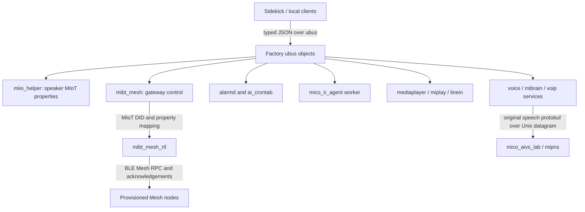

# Report: LX06 Factory Protocol Reverse Engineering

## Scope and evidence rules

This report combines the LX06 firmware 1.94.13 runtime ubus inventory with static analysis of the extracted factory root filesystem and prior reverse-engineering reports. A live method signature proves only that a running ubus object publishes a method schema. Static strings, imports, call sites, state files, and logs help recover implementation paths but do not prove an end-to-end operation. Any behavioral inference is labeled as such.

For the Mesh daemon, the executable currently running on the device was read through `/proc/3518/exe` into ignored `temp/analysis/`. Its SHA-256 is `bc5c03e56190d23aaf284ec059785e1ed62fb47261b45f41a30dd8e944cb7bac`. The extracted ROM copy has SHA-256 `d9f7b4af9cb7e886063b99b0c62448f203d9ba21244f4de9ae1021911f4aec8a`, so static findings below use the active binary where identified. Other inspected executables under `temp/rootfs-factory-full/usr/bin/` matched the active device executable hashes for `miio_helper`, `alarmd`, `mico_ir_agent`, `mico_ai_crontab`, `mediaplayer`, `mibrain_service`, `mico_aivs_lab`, `linein`, and `voip_service`.

The runtime signature snapshot is preserved in [all 26 ubus objects and 260 method signatures](factory-runtime-ubus-signatures.md). No scan, pairing, binding, property write, scene action, IR learning/transmit, alarm update, call action, setter, or generic RPC was invoked during this reverse-engineering pass. No Mesh key, account credential, contact, or user configuration value was read or included.

## Protocol layers

The speaker exposes several distinct interfaces. Their method names should not be merged into one generic “Xiaomi control” protocol.

The diagram shows the interfaces and implementation links found in signatures and binaries. It does not mean that Sidekick currently calls every path or that each path is authorized for an arbitrary local client.

### Local `ubus`

`ubus` is the speaker’s local RPC bus. Calls and replies use typed blob messages commonly rendered as JSON by the `ubus` CLI. The 260 signatures include strings, integers, booleans, arrays, tables, and methods without arguments. Signatures do not define required fields, enum values, ranges, identity checks, ACLs, or return schemas; those require handler analysis or controlled read-only examples.

The project exposes a separate fixed JSON tool directory through its local Unix socket and HTTP console. That directory is not a raw ubus proxy. The existing tool contract and call boundary are documented in [control protocol](../reference/control-protocol.md) and [tool integration evidence](speaker-capability-tools-integration.md).

## Speaker MIoT properties and night mode

### `miio_helper`

The active `/usr/bin/miio_helper` matches the extracted ROM copy. Its imports include JSON parsing/building, ubus invocation, volume and microphone setters, and the night-mode helpers. Static handler messages identify `handle_get_properties`, `handle_set_properties`, and action lookup by `siid/aiid`; an unknown action is explicitly logged as unsupported. These are implementation clues for a bounded property/action dispatcher, not proof that every MIoT method is supported.

The binary contains these property/action names:

| MIoT-facing name | Likely local operation from the handler name/imports | Evidence limit |
|---|---|---|
| `set_microphone_MicrophoneMute` | Microphone mute | Exact payload and allowed values not recovered |
| `set_speaker_SpeakerMute` | Speaker mute | Exact payload and allowed values not recovered |
| `set_speaker_SpeakerVolume`, `set_speaker_up`, `set_speaker_down` | Speaker volume | Value scale and error mapping not recovered |
| `set_speaker_SpeakerRate` | Playback rate | Enum/range not recovered |
| `set_IntelligentSpeaker_SleepMode` | Speaker sleep mode | Relation to `nightmode.sleep_mode` not fully recovered |
| `set_NoDisturb_NoDisturbSwitch`, `set_NoDisturb_EnableTimePeriod` | Do-not-disturb switch and period | Exact fields, time semantics, and persistence not recovered |

The generic `miio.miot_rpc` ubus method accepts no declared fields in introspection, while the binary logs a JSON parse failure and contains get/set-property handlers. This does not establish a safe public call schema. Do not expose `miot_rpc` as a model tool or send arbitrary JSON to it.

### `nightmode`

Runtime introspection publishes `nightmode.set(total, light, volume, start, stop)` with String parameters, `nightmode.sleep_mode(value, from)` with String parameters, and read-only `status`/`current` methods. The init script creates `/data/etc/nightmode.cfg` on first boot with total/light/volume `night`, start `22:00`, stop `06:00`; PNS reads `nightmode.current.volume`. A current device read returned configured `sleep_mode=normal`, `total/light/volume=night`, `22:00–07:59`, while `current` returned `normal` for all three active values.

Static disassembly now distinguishes the two write paths: `nightmode.sleep_mode` calls helpers that use `cfg_set_string` for `sleep_mode` (`night`/`normal`) and `sleep_mode_flag` (`true`/`false`) in `/data/etc/nightmode.cfg` when its computed state changes. The separate `nightmode.set` handler still has no proven write/commit path. This proves config-set calls, not atomicity or durable commit semantics. It does not reveal complete enums, whether start/stop boundaries are inclusive, how `value/from` interact, or whether setters notify all consumers. The observed stop time differs from the init default, so callers must preserve the read value instead of reconstructing it from defaults. No setter was called. Further evidence is in the [deployment validation report](speaker-tools-deployment-and-device-validation.md#睡眠模式与米家-mesh-只读调查).

## Bluetooth Mesh and MIoT child-device protocol

### Control plane and inventory model

The live `mibt_mesh` ubus object publishes `mesh_status`, `mesh_scan(caller)`, `mesh_bind(is_cancel)`, `mesh_enable(caller)`, `mesh_disable(is_need_reboot)`, `wakeup_tv(tv_mac)`, and `miconnect_enable(interval, action)`. The live status reports Mesh support, enabled state, running state, and `BTMESH_IDLE`. These methods control or describe the gateway; they are not themselves the property protocol for each child device.

The active `mibt_mesh_rtl` binary contains `_local.miot_device_scan` and its result event, `_local.miot_bind_device` and its result event, `device_list`, `subDid`, `dev_did_list`, `group_did`, and product-rule structures. Its logs track a child device by MIoT `did`, product ID `pdid`, BLE MAC, Mesh unicast address, element count, RSSI, and parent/child relationships. It parses supported property/event rules keyed by `siid`, `piid`, `eiid`, and product ID. This is direct static evidence that the gateway implements a child-device model and scan/bind message paths; it corrects the earlier assumption that the firmware only had a gateway-status path.

### Property and scene path

The active binary contains the MIoT message names `get_properties`, `set_properties`, `miIO.miot_scene_read/add/del/recall`, and `_sync.miot_scene_status`. It imports or references `mible_mesh_rpc_get_properties`, `mible_mesh_rpc_set_properties`, and `mible_mesh_rpc_query_pdid_model`. Strings show property requests being resolved against per-product rules, responses associated with DID/address/SIID/PIID, acknowledgements with transaction IDs and retry counts, and explicit failures for unknown property rules. Scene recall status includes a result code and delay.

The likely child-property path is: resolve the DID and product model; map SIID/PIID to a supported rule and data type; dispatch the request through the local JSON proxy; send a Mesh RPC; correlate the response/acknowledgement; publish MIoT status. The envelope fields `id`, `method`, and `params` are now directly identified in the proxy dispatcher, while this end-to-end sequence remains an inference from cross-linked structures, function names and logs, not a captured packet trace. The exact method-specific JSON schemas, BLE Mesh opcode/body encoding, value serialization, retry limits, cloud fallback, account ownership checks, and user-facing device-list method remain unresolved.

### Explicit handler-registration tables (active ELF static)

The active `mibt_mesh_rtl` ELF has two name-to-handler tables referenced by registration/traversal code: table A at file offset `0x1f5cbc` / VMA `0x215cbc`, table B at file offset `0x1f5dc4` / VMA `0x215dc4`. Pointer references occur at file offsets `0x72db0`, `0x72f50`, `0x730f4` (table A) and `0x730e0` (table B); a registration/traversal helper is around VMA `0x82dc0`, with the second table path around `0x82f64`. This strongly confirms a static handler-registration/dispatch table. The active binary is the previously hashed running ELF and differs from the factory ROM copy; use it only for its recorded version context.

Registered methods include `_local.open_mitv`, `_local.disable_gateway`, `_local.send_adv_cmd`, `_local.mesh_gateway_status`, `_local.miot_device_scan`, `_local.miot_bind_device`, `_local.prov_state_get`; `get_properties`, `set_properties`, `action`, `miIO.ble_mesh_delete_dev`; BLE bind/unbind notifications; MIoT group add/delete v1/v2; MIoT scene read/add/delete/recall; and Mesh ascribe/demote, relay/TTL/friend/network get/set controls. The full method-to-handler VMA map is in the [ROM feature coverage ledger](factory-rom-feature-coverage.md#bluetooth-mesh-child-device-method-dispatch-static).

Property handler entries are `get_properties` at VMA `0xaa8c0` and `set_properties` at `0xab250`. Their literal/callsite evidence identifies outer fields `params`, `connect_type`, `from`, `id`, `_from`, `_to`, `result`, `msg_queue_num`; property keys `did`, `siid`, `piid`, optional `_no_cache`, and a `group.` route; set additionally uses `tid` and `value`. Both route into `mible_mesh_rpc_*_properties` helpers. Errors mention gateway-not-ready, unsupported group get, missing unicast address/device/product rule and unsupported PIID/device type. This is a recovered field-name/error vocabulary, not complete requiredness, JSON type/range, result body or code mapping. Transaction IDs/retry counts appear on ACK paths; event logic includes a replay check.

The product/property support table is dynamically rule-driven: query callbacks fetch or resolve rules keyed by `pdid`, then insert/load/update/cache/commit paths track `siid`/`piid`/`eiid`, property/event counts and TTL. This suggests a dynamic product-spec source, but a complete supported-product table was not recovered. Auth/unknown/denied lists and missing ACK/device-info errors show eligibility gating; they do not identify the authorization authority, account ownership or exact decision rules. No current node/product records were read and no request was sent.

### Local Mesh proxy transport

Disassembly of the active `mibt_mesh_rtl` ELF identifies `/tmp/mibt_mesh_proxy.sock` as a local Unix-domain server path. Its initialization removes a stale path, calls `socket(AF_UNIX, SOCK_SEQPACKET, 0)`, binds the pathname, and listens with backlog 4. The setup also invokes a helper that applies descriptor flags; the exact nonblocking behavior is not needed to identify the transport. A separate receive loop calls `read()` with an 8192-byte buffer and passes each positive read to an internal message wrapper. That wrapper initializes a 76-byte event record, sets its first two bytes to `4` and `1`, attaches the payload pointer and length, and passes the tagged record to internal handler `0x81cfc`. The subsequent event semantics have not yet been fully resolved, so this report does not label the callee as a confirmed queue.

The matching factory `miio_helper` ELF contains the same socket pathname. Its call site passes the path to a helper with the names `btmesh` and `mibt_mesh`; that helper creates an `AF_UNIX/SOCK_SEQPACKET` socket and calls libc `connect()` with a Unix socket address. After connection, it initializes `ustream_fd`, installs send/receive callbacks and a JSON tokener. The receive callback reads up to 4096 bytes per `ustream_read` chunk and calls `json_tokener_parse_ex`; the dispatcher extracts integer `id` for pending-response correlation, then otherwise extracts string `method` and object `params` for local method dispatch. The send callback calls `send(fd, buffer, length, 0)` and does not append a newline. Together these call sites directly identify a JSON, request/response-like envelope using `id`, `method`, and `params` over the local socket.

The exact requiredness and method-specific `params` schemas, response/result/error shape, and packet behavior for messages above the read buffer sizes remain unresolved. The daemon's 8192-byte `read()` size and client's 4096-byte `ustream_read` size differ; no oversize behavior has been established. No successful request/response exchange was captured. Strings also name `/tmp/central_service_lite.socket` and separate client callbacks; those are not shown to be part of this Mesh proxy exchange. No socket was opened or data sent during this analysis. The analysis used static ARM disassembly of the active daemon and matching factory `miio_helper` ELF.

Static messages include an authorization list, denied list, product-rule query, and failure to obtain a device DID list. They indicate that authorization and product metadata affect the path. They do not prove which Mi Home account is authorized on this device or whether current saved nodes can be safely surfaced to Sidekick. The device’s Mesh keys and persistent node database were deliberately not read. No scan or bind request was sent.

`libxiaomi_miot.so` remains a different component: its defined public dynamic symbols are UDID identity helpers, not a complete local appliance-control API. The usable-looking Mesh path lives in `mibt_mesh_rtl` and its supporting libraries, and still needs a typed, authorized inventory source before Sidekick can call it safely.

## Central Lite, IDM and local discovery paths

`central_lite` creates `/tmp/central_service_lite.socket` as an `AF_UNIX/SOCK_SEQPACKET|SOCK_NONBLOCK` listener and binds/listens. The `mibt_mesh` ELF creates an `AF_UNIX/SOCK_SEQPACKET` client and connects to the same pathname. This directly establishes local IPC between the two executables; it does not imply LAN or cloud connectivity. Both contain `local.get_gateway_role` and `local.gateway_role_change`; the Mesh ELF has a JSON notification template with `method`, `params.role` and `id`, supporting a gateway-role exchange on this channel. The complete method set and request/reply correlation remain unresolved.

`central_lite` also imports DNS-SD browse/resolve/address helpers and contains `_miot-central._tcp` and `Mijia Device` strings. This establishes discovery/publication code paths, not an observed advertisement. The `central_lite` init script's `START=81` is commented; `idmruntime` declares `START=79`, skips Bluetooth work mode, and otherwise starts under procd. The latter has CoAP/mDNS/IDM service/request/response symbols but no reference to the central Unix socket, so these are separate evidence paths until a call relationship is found. `simple_dhcp.sh` includes a QLink CoAP success notification at `/qlink/success` port 5683, also distinct from the IDM schema. No network traffic or mdns configuration was inspected.

## Alarms, scheduled skills, and notifications

### Alarm database and operations

`alarmd` publishes alarm create/query/modify/open/close/delete plus work-mode, microphone-mute, chime-hourly, alarm-volume, and store-show methods. The main alarm schema includes `type`, `timestamp`, `circle`, `volume`, `event`, `extra`, `behavior`, ringtone fields, display text, and reminder fields. Static strings show validation of timestamp/circle/volume/behavior, weekday parsing, per-entry files under `/data/alarm/`, and stored keys including circle, volume, status, event, and update timestamp. Recurring alarm logic consults workday and holiday files and updates expired alarm times.

Alarm playback can use preloaded or real-time resources and calls the media player. The daemon also reports alarm data to `mibrain`, synchronizes alarm-ring state with touchpad and PNS events, and has separate microphone-mute timers. The project has already verified a narrow one-shot alarm create/close/open/delete flow; this does not validate recurring weekday rules, modification semantics, reminder text, ringtone selection, work mode, or microphone mute. Preserve the prior scope and limits in [speaker capability integration](speaker-capability-tools-integration.md).

### Hourly chime and store-show mode

The hourly-chime subsystem has its own files under `/data/chimehourly/`, including status and schedule files; it can preload a chime or play a real-time resource, change/restore player volume, and post `Alerts/ChimeHourly` through `mibrain.aivs_event_post`. It refuses playback when not allowed by current status. Exact schedule array shape and the full on/off enum still need handler-level confirmation.

The store-show methods manage a separate status/configuration with fields for status, automatic silence, default-volume behavior, a silence countdown, and default volume. Static messages show this state being synchronized with touchpad/PNS and the player. This appears to be a retail/demo behavior, not a normal alarm control. The exact status enum is not inferred from names alone.

### `ai_crontab` personal skills

`mico_ai_crontab` stores persistent data under `/data/ai-crontab/crontab.dat` and working state under `/tmp/ai-crontab/`. Its `new` ubus method receives one `personal_skill` String. Static parser messages show a JSON object with a `cmds` collection; each entry is expected to contain a `cmd` object, a `type`, and optionally a `duration` (missing duration receives a default). It maintains busy/free task lists, executes through `mibrain.ai_service`, and correlates `play_finished` notifications by source/event/id while ignoring stale IDs.

The nested JSON schema, task type enum, duration units, cleanup rules, and command allowlist were not recovered. Do not expose `ai_crontab.new` or accept model-generated `cmds` as a trusted schedule.

### `notify`

The runtime object supports create/query/delete/play/stop/clean/status/set. Its signature includes ID, level, expiry, volume, text, enable, and autoplay fields. The method names show both notification storage and playback controls, but no handler analysis has yet established ID scope, level enum, expiry units, persistence, or whether `play` chooses one item or the queue. Treat notification text as user data and do not return it to the model without a defined privacy policy.

## Infrared and local appliance actions

`mico_ir_agent` registers `play`, `play_batch`, `learn`, `learn_stop`, `read`, and `codec`. Runtime signatures expose frequency, code, async, interval, header, learning key, codec type, and length. Static strings show a separate worker, an `encode`/`decode` path through `libir-agent-codec.so`, a key-scoped learn/read state, timeout handling, duplicate-key handling, and rejection of a stop/read request whose key does not match the active learning operation.

This is more than a raw ubus method list: learning is a stateful protocol with a correlation key and timeout, while play accepts a code/frequency and batch adds interval/async fields. Exact code framing, supported carrier frequencies, batch bounds, learning timeout, and result format remain unknown. Sending a code controls an external appliance and learning may capture a remote signal. Neither operation should be exposed as an unconstrained model tool.

## Player, Line-in, casting, and groups

The `mediaplayer`, `linein`, `mdplay`, and `miplay` objects form a separate media-control plane. Static player strings show shutdown-timer set/cancel parsing, sleep actions, timer callbacks, line-in start/stop and restore timers, Aux prompt playback, play-rate control, private-FM playback, DLNA status, and dispatch to miplay casting. The project has previously tested the shutdown-timer setter and cancel paths; both returned code 162 and left the timer type at 0. A published method signature therefore must not be presented as a working setter.

The casting interface has read/status and explicit pause/resume/quit/toggle operations, plus `casting_do(cmd, args)` with opaque strings. The miplay helper parses an `info` result and a `casting` member, checks `code`, and issues `casting_quit` in a stop path. Player logs show group discovery and `change_speaker_group(groupInfo)`. These findings establish an internal call path but not the accepted command schema, target identity rules, cross-speaker behavior, or rollback. Do not expose `casting_do` or raw `groupInfo` to a model.

The existing playback protocol analysis is in [music stream and playback control](on-device-music-stream-and-playback-control.md); [audio pipeline](../reference/audio-pipeline.md) owns capture/output details.

## Voice print, child mode, and VoIP

- **Voice print:** `mico_aivs_lab` creates `/tmp/mico_aivs_lab/voice_print_w.fifo`, `voice_print_r.fifo`, and a registration marker. Static strings show an asynchronous registration state machine (`REGISTER_IDLE/ING/FAIL/SUCCESS`) and that speech recognition closes cloud VAD during registration. Ubus exposes status, network-info, recognize/payment registration, and cancellation. These operations handle biometric/payment enrollment state; do not invoke or expose them through a general assistant tool.
- **Child mode:** the voice client calls `path_child_mode.set` with a nested JSON string containing `isChildMode`. This confirms the producer’s wire shape for that call; the setter’s side effects, persistence, and whether the wrapper accepts only JSON booleans remain unverified. `path_child_mode.status` is the obvious read path but its response schema is not yet traced.
- **VoIP:** runtime `voip.action` includes vendor, event, contact ID, number, name, and string fields. The bundled helper documents event names for query/ringing/wakeup/play/mute, inbound/outbound calls, pickup/hangup, and log upload, and reads carrier configuration/duration. The service returns status/vendor information. These methods can place, answer, or end calls and include personal contact/phone data; no call action was tested, and this is not suitable for unrestricted model use.

## System and credential interfaces

The runtime also exposes `system.reboot/sysupgrade`, `service.add/set/delete/signal`, `miio.register/connect/drop/token_write`, Wi-Fi configuration, vendor switching, AIVS token/event methods, DHCP lease queries, and watchdog controls. Current evidence is limited to signatures and selected binary strings. Their exact ACLs, nested schemas, persistence, and failure behavior have not been exhaustively reversed. The existence of these methods is a reason to keep the model interface allowlisted; never forward arbitrary ubus method names, generic `miot_rpc`, `casting_do`, service scripts, credentials, or raw factory cloud payloads.

## Existing protocol notes and remaining work

Several protocol families already have deeper, topic-specific records and remain the authority for those subjects:

- Original wake/audio session protobuf and Unix datagram messages: [factory session and callback analysis](factory-session-and-callback-analysis.md).
- Native TLS/WebSocket transport and factory library boundaries: [factory libraries and cloud transport](factory-libraries-and-cloud-transport.md) and [audio frame/authentication flow](audio-frame-and-authentication-control-flow.md).
- Local Sidekick HTTP/JSON/SSE and tool socket contract: [control protocol](../reference/control-protocol.md).
- Player queue and streaming: [native music stream and playback control](on-device-music-stream-and-playback-control.md).
- Runtime ubus signatures: [signature capture](factory-runtime-ubus-signatures.md).

This pass recovers implementation structure for the high-value subsystems above; it does not claim to have decoded all 260 methods. Remaining unknowns include method ACLs, complete return schemas, all enum/range constraints, persistent-state schemas, cloud message envelopes, child-device authorization provenance, and behavior on other firmware versions. The next safe analysis should focus on static call chains and schemas for a specific user-facing feature, then document a typed boundary before any operation is considered for Sidekick.
