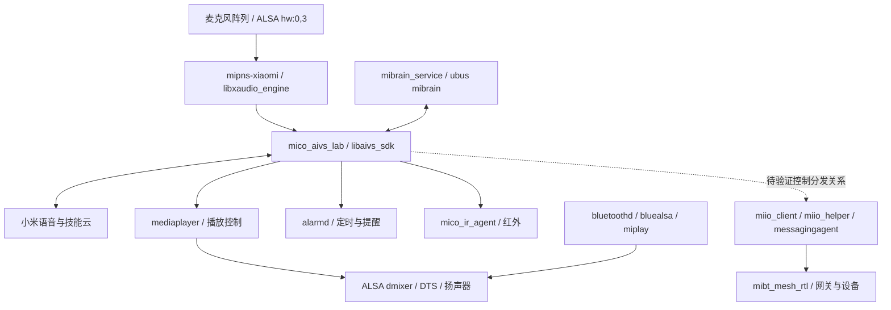

# Report: LX06 System and Doubao Integration Feasibility (Historical Analysis)

版本：第一轮实机与固件分析。记录日期：2026-11-01（北京时间）。
设备：用户自有小爱音箱 Pro LX06；ROM 1.94.13；SSH <speaker-ip>。

## 文档状态与结论

这是 2026-11-01 基于当时设备与固件状态编写的可行性分析，适合作为设计决策的历史依据，不代表当前部署状态。报告确认 LX06 资源、原厂服务和协议边界，并提出分阶段接入建议；它明确指出当时尚无可靠的会话分流方案，也没有证明全部原厂功能已回归。当前状态应查阅项目的有效状态参考文档及后续实测报告。

## 结论与决策

在音箱内运行轻量程序、直接连接豆包云端，同时保留原厂服务，有明确的工程可行性基础：SSH 已验证、共享采集成功、豆包相关域名 TLS 连通、原生播放及 Mesh 状态查询成功。但本轮未接入用户豆包凭据、未调用付费模型、未实现语音替换，不能报告“豆包替换已经完成”。

“保留所有原有功能”应采用原厂服务共存和逐项回归，而不是停止/卸载小米服务。米家、音乐、蓝牙、红外、闹钟、通话分布在多个进程中；小米语音服务仍可能是许多功能的执行入口。豆包不是替换一个模型文件或修改一个 URL：小米云端指令与豆包 API 的格式、鉴权、语音事件和工具执行语义不同，需要一个机内适配层。

建议：先实现不接管原交互的旁路观察和文本调用验证，再实现按会话接管、原生能力回退，最后做豆包全双工音频。不能用“读取最终识别日志后重启小爱进程”作为保留全部功能的正式方案。

当前最关键的未决问题是：怎样在原厂执行回答/技能前，可靠地决定该轮交给豆包，且不让两边重复说话或重复控制设备。

## 1. 证据与分析方法

证据分为：实机读取/短测、原厂镜像静态分析、开源代码、官方云接口资料、尚待验证的工程推断。本报告没有把接口存在当成端到端功能通过。

本轮执行了：
1. SSH 读取内核、CPU、内存、MTD、挂载、进程、监听端口、启动脚本及 ubus 对象签名。
2. 对 boot0、boot1、system0、system1 重复读取并比较 SHA256，均与首次备份一致。
3. 用官方 7-Zip 23.01 可移植文件解包本机原厂 system0 和上游补丁；对原厂两个系统镜像及补丁做归档完整性测试，均返回 0。
4. 对成功解出的普通文件做 SHA256 比较，记录新增/变更；对音频库做逐字节比较。
5. 下载并阅读 Open-XiaoAI 源码，尤其是录音、播放、指令监听和原生小爱命令桥。
6. 只读查询播放器与 Mesh，执行一次 1 秒录音到 /dev/null；音频未保存或上传。
7. 不带凭据访问豆包文本与语音域名，验证 DNS/HTTPS/证书，不推断模型调用已可用。

原始记录在 ../logs/，文件清单与差异在 ../temp/manifests/。没有停止原厂服务、修改米家绑定、修改音量或闹钟，也没有安装 Agent 开机项。

## 2. 本机硬件、系统和资源

| 项目 | 本机证据 | 解释 |
|---|---|---|
| CPU | /proc/cpuinfo：4 核，ARM implementer 0x41 / part 0xd03 | Cortex-A53；公开拆解对应 Amlogic A113X |
| CPU 频率 | cpuinfo_max_freq、scaling_cur_freq 均 1200000 kHz | 本次暴露上限/当前为 1.2GHz，不凭 BogoMIPS 估频 |
| 内核 | Linux 4.9.61 aarch64，2025-09-16 构建 | 64 位内核 |
| 用户态 | busybox 与 mico_aivs_lab ELF class=1、machine=0x28 | 32 位 ARM；新动态程序要匹配 ARM 用户态 ABI，而非仅看 uname |
| 发行基础 | /etc/openwrt_release：LEDE SNAPSHOT，meson/axg_32，glibc | OpenWrt/LEDE 衍生系统，不是 Android 用户态 |
| 内存 | 启动日志 131072K；MemTotal 118760 kB | 内核收到约 128MiB RAM；不能继续按公开样机 256MB 做预算；物理芯片是否另有保留区域未验证 |
| 当前可用内存 | 多次 MemAvailable 约 50,000 kB；无 swap | 约 49MiB 是当时快照，不是稳定保证额度 |
| 闪存 | 已列 MTD 分区合计 122MiB；公开拆解芯片为 128MiB | NAND；剩余区域用途未完整核对，不能像普通磁盘随意改分区 |
| 根文件系统 | squashfs 只读，/dev/mtdblock4 | df 100% 正常，不意味着内存或 data 满 |
| 可写 /data | 13.3MiB 文件系统，空闲约 8.2MiB | 优先限制新程序总安装体积，避免 SDK/大型运行时 |
| /tmp | 约 58MiB tmpfs | 使用的是 RAM，不能作为免费大缓存 |

关键进程的 RSS 快照：mipns-xiaomi 约 14.2MiB、mico_aivs_lab 5.3MiB、messagingagent 5.8MiB、mediaplayer 3.1MiB、miio_client 1.4MiB、Mesh 1.6MiB。RSS 含共享页，不能直接求和当作独占内存。ps 显示的 348m 等数字是虚拟空间，不是实际吃掉几百 MB。

原系统采样 load average 约 4～5；本轮没有持续 CPU 利用率测量，不能把这个值直接解释为 CPU 满载或仍有很多余量。

## 3. 启动、分区和备份边界

实读启动选择为 boot0，bootdelay=15。原厂 rootfs 构建信息与 App ROM 一致为 1.94.13。

| MTD | 名称 | 实机分区字节数 | 当前处理 |
|---|---|---:|---|
| 0 | bootloader | 2097152 | 已备份，未改写 |
| 1 | tpl | 8388608 | 已备份，未改写 |
| 2 | boot0 | 6291456 | 已备份并双读一致，未改写 |
| 3 | boot1 | 6291456 | 已备份并双读一致，未改写 |
| 4 | system0 | 41943040 | 原厂已备份；SSH 补丁写入且读回哈希匹配 |
| 5 | system1 | 42074112 | 仅前 41943040 字节读出；完整 SquashFS 可校验，尾部有读取错误 |
| 6 | data | 20840448 | 已备份；未更改账号配置或用户数据 |

重要发现：备用 system1 内的 ROM 是 1.88.221，不是 1.94.13。不能把“切到 boot1”描述为回到同版原系统，也未实际执行该回退。

对 system1 尝试从 Linux 读取到分区尾时，超过 40MiB 的部分遇到 I/O 错误。启动日志同时记录工厂坏块。具体坏块映射与尾部读取失败的关系尚未完全分析，不能把它简单归结为设备已损坏，也不能称全部闪存完整备份成功。失败读取副本已放到 rom/system1-ssh-read-partial.img；不冒充完整备份。未做写入恢复试验。

补充：boot0 的 ANDROID! 只是启动镜像容器格式，不证明音箱运行 Android 应用系统。

## 4. 原厂软件架构

实读 /etc/init.d 和进程清单显示由 procd 监管，并通过 /etc/rc.d 排序启动。主要次序包含 miio_client=62、messagingagent=70、mico_aivs_lab=85、mibrain_service=96。部分蓝牙/Mesh/投播服务由其他事件启动，不能只靠 rc.d 排序理解全部依赖。

组件作用以启动配置、命名和接口综合判断：
- mipns-xiaomi：原厂拾音前端，与语音进程有 Unix socket 通道；其 DSP/回声消除内部算法没有完全逆向。
- mico_aivs_lab：连接语音 SDK、处理 SpeechRecognizer 等指令、分发语音相关行为。必须保留，直到原有能力逐项替代并验证。
- mibrain_service：提供 ubus 语音/文本请求入口及 SDK 通信封装。
- mediaplayer：音乐、TTS、音量、播放队列及状态。
- miio_client、miio_helper、messagingagent、miio_mpkg：米家接入与消息相关服务；存在不等于控制链路已完整还原。
- mibt_mesh_rtl 实际从 /data/miio_mpkg/bin 启动，说明运行版本不一定等于只读 rootfs 自带版本。
- alarmd、mico_ai_crontab、mico_ir_agent、voip_service、linein、bluetoothd、bluealsa：原厂功能各自有依赖。

## 5. 已确认的协议与可复用接口

### 5.1 本地 ubus

它是音箱内部 RPC/事件机制，命令行呈现 JSON，不等于网络 HTTP API。已枚举参数签名，见 logs/system-inventory.txt 的 ===UBUS=== 部分。

| 对象/方法 | 用途 | 本轮验证程度 |
|---|---|---|
| mibrain.vendor_who | 语音供应方查询 | 实调用 code=0、xiaomi |
| mibrain.ai_service | ASR/NLP/TTS 请求；含 nlp_text、nlp_execute、tts 等参数 | 签名实读，开源代码使用；本轮未执行文本技能 |
| mibrain.text_to_speech | 合成文字，可保存/播放 | 签名及原厂 tts_play.sh 实读；未发声测试 |
| mibrain.aivs_event_post | namespace/name/payload 事件入口 | 签名实读；不是已验证的任意米家控制接口 |
| mediaplayer.player_get_play_status | 播放状态/音量 | 实调用 code=0，空闲状态 |
| mediaplayer.player_play_url | URL 播放 | 签名实读；未播放 |
| mediaplayer.media_control、音量方法 | 播放与音量管理 | 签名实读，行为未测 |
| alarm.alarm_* | 原厂闹钟增删改查 | 签名实读；未读取用户闹钟内容或修改 |
| mibt_mesh.mesh_status | 网关运行状态 | 实调用支持/启用/运行均 true |
| pnshelper.event_notify | 唤醒、麦克风等事件 | 签名实读，事件编号参考源码；未切换麦克风状态 |

开源 SpeakerManager::ask_xiaoai 通过 mibrain.ai_service 向原小爱提交文本。这支持后续让豆包把“打开客厅灯”交给原厂执行，但必须验证本机执行结果、超时和去重；接口返回成功不一定等于灯真的打开。

### 5.2 语音事件与网络层

源码监听 /tmp/mico_aivs_lab/instruction.log 中 SpeechRecognizer.RecognizeResult 的最终结果。当前目录仅观察到 event.log，尚无 instruction.log。二进制含 instruction.log 字符串，说明相关机制有线索，但不是已经可用；不能把 tail 这个文件当成完成接管。

mibrain_service 二进制可见 /tmp/mico_aivs_lab/usock/common.usock；拾音进程可见 speech.usock。只发现路径/使用线索，未还原 Unix socket 消息格式。

miio_client 当前有本地 TCP 54322/54323 和 UDP 54321。端口事实不代表可以不经授权直接控制家里所有设备。小米云语音、MIIO/MIoT、蓝牙 Mesh、音箱内部 ubus 是不同层次。

Open-XiaoAI 的 WebSocket/RPC 是社区项目自建的客户端与 Server 通信，并非小米原厂协议。机内实现可以移除这段外部 Server 跳转。

## 6. 已刷入补丁到底改变了什么

| 改动 | 实际影响 |
|---|---|
| dropbear、inittab、PAM、shadow | 开放 SSH/登录行为和默认认证；不展示密码哈希 |
| rc.local | 增加 /data/init.sh 启动入口 |
| ota、flash.sh、wireless | 阻止原厂自动升级路径 |
| asound.conf、asound.conf.dts | 使用 dsnoop 共享录音硬件 |
| libxaudio_engine.so | 偏移 773628 起 6 字节，从 hw:0,3 改为 noop 加空字节 |
| wireless.orig 新增 | 打补丁时保留的脚本副本 |

上述音频库差异逐字节核对共 6 字节；mico_aivs_lab、mibrain_service、mediaplayer 等核心程序普通文件哈希未改变。

因此补丁远不止“开启 SSH”。尤其 OTA 已明确改变原厂功能，严格的“所有功能保留”当前尚不满足。后续必须决定如何提供可维护的升级/补丁重应用流程；此轮没有擅自恢复 OTA，以免自动升级覆盖改造或 SSH。

音频共享设置为 hw:0,3、48kHz、S32_LE、8 通道，再由 plug 做转换。原厂输出含 dmix、softvol、DTS；新程序应走既有混音链，不独占声卡或重配硬件。

## 7. 豆包接入的推荐架构

### 7.1 两阶段演进

第一阶段：保留原厂拾音、语音识别和执行链，接入豆包文本对话，验证按会话接管与原生工具。优点是复用原来远场拾音，改动最小；缺点是仍依赖小米 ASR/TTS，并且必须先解决原回答抑制/分流时机。

第二阶段：机内轻量音频客户端直连豆包实时语音，豆包负责 ASR/对话/TTS；米家、音乐、闹钟等继续通过本机适配层调用原服务。优点是更贴近用户期待的自然对话；难点是共享采集不等于获得处理后的 AEC 音频，需实测远场与播放回声。

这两阶段均不需要额外常开电脑。电脑仅用于开发、交叉编译、日志分析；云端模型仍需要网络。

### 7.2 一轮交互的职责

- 唤醒/会话：沿用原唤醒，给每次会话分配本地 ID；原生会话、豆包会话和用户关闭麦克风状态分开管理。
- 路由：优先处理停止、静音、闹钟等系统控制；明确原生技能进入原厂链；开放聊天进入豆包；不确定时保留回退。
- 工具：定义受限的 execute_native_intent、media_control、volume_control 等类型化接口。豆包只能提交结构化参数，禁止把模型生成内容当 shell 脚本执行。
- 去重：同一轮/同一个 tool call 只执行一次。网络重连不能重放“开灯”“设闹钟”等动作。
- 输出：新唤醒/停止时取消云端回答并清掉本地缓存，避免旧答案继续播放；闹钟/通话优先，音乐恢复必须检查之前是否由本会话暂停。
- 故障：豆包断网或进程退出时，原生小爱链可继续工作；在可靠分流实现前不全局禁用原厂语音。

### 7.3 官方协议选择

豆包文本接口与实时语音是不同产品/协议。当前官方实时语音 3.0 文档有全双工接口、结构化工具调用和取消回答事件；旧版实时语音使用不同的二进制事件协议。实现时必须锁定版本，不能混用事件帧。

官方资料：
- [实时语音 3.0 接入](https://docs.volcengine.com/docs/doubao-voice/end-to-end-real-time-voice-full-duplex-version?lang=zh)
- [旧版实时语音协议](https://docs.volcengine.com/docs/doubao-voice/end-to-endreal-time-speech-large-model-api-access-document?lang=zh)
- [文本 ChatCompletions 官方 API Explorer](https://api.volcengine.com/api-explorer/?action=ChatCompletions&groupName=%E5%AF%B9%E8%AF%9D%28Chat%29+API&serviceCode=ark&tab=3&tab_sdk=GO&version=2024-01-01)

账号已拥有某个豆包文本 API Key，不等于已经开通实时语音产品或相应资源。正式接入前在本机填写所选服务凭据并验证权限；不要求把密钥发送到聊天中。

## 8. 音频、资源与源码复用的具体限制

短测：arecord -D noop -r 16000 -f S16_LE -c 1 -d 1 /dev/null 返回 0；原拾音进程 PID 前后均 1282，未保存内容。它只证明能并发打开并读出，不证明音量正确、语音清楚或无回声。

源码在 record.rs 专门以 S32_LE 采集，再对 A113 的低 24 位数据做移位/限幅转换。直接使用 ALSA 默认 S32->S16 转换可能电平不合适；下一轮必须比较波形统计、语音识别率和远场效果，不能因为 arecord 成功就跳过。

建议新程序优先 C 或裁剪后的 Rust，匹配 32 位 ARM/glibc；复用 libubus/ALSA/libcurl。系统 curl 7.55.1、OpenSSL 1.0.2l 没有现代 libcurl WebSocket 接口，不能直接把 curl 命令当实时语音客户端。需要编译兼容的 WebSocket/TLS 适配程序或小型库，验证老 glibc、指令集、证书和内存。

初始工程预算（目标而非实测）：新增程序/依赖不超过约 3MiB；新增稳态 RSS 争取小于 10MiB、峰值小于 20MiB；音频有界缓冲、对话历史设上限、日志放 /tmp 并轮转。数字需由原型和长时间回归修订。

不建议机内放 Node/Python 大型依赖树、浏览器、桌面网易云客户端或本地聊天模型。新增依赖不能通过删除原厂库/功能来腾空间。

源码有直接字符串替换拼接 shell/JSON 的例子，也有用重启 mico_aivs_lab 作为 abort 的做法。正式程序不能照抄：前者需要可靠转义或直接 libubus 调用，后者可能损失正在进行的原生会话。源码 10ms 轮询日志也应改为合适的事件/文件通知与重连管理。

## 9. 功能保留验收表

| 功能 | 当前证据 | 下一轮验收要求 |
|---|---|---|
| 原唤醒/远场识别 | 原拾音进程在，短测未重启 | 不同距离/噪声、豆包并发时各轮成功率 |
| 原厂聊天与技能回退 | 原语音程序及接口保留 | 豆包开关、断网、异常退出后的回退 |
| 米家 Wi-Fi 设备 | miio/消息服务运行 | 用户指定一盏灯，原语音与豆包各测，核对实际状态 |
| 蓝牙 Mesh 网关 | 状态查询支持/启用/运行 true | 控制已绑定设备，重启后仍可控 |
| 红外 | mico_ir_agent 在 | 指定遥控设备，核对状态及去重 |
| 原音乐及内容服务 | mediaplayer 存在/状态查询成功 | 点歌、暂停、继续、换歌、队列、会员授权 |
| 蓝牙音箱 | bluetoothd/bluealsa 在 | 手机配对、播放、切回 Wi-Fi、音量 |
| AUX 输入/DTS | linein、原输出链保留 | AUX 播放与切换、音质和音量无回归 |
| 投播/组网 | 相关代码/服务配置存在 | 以本机原有支持范围逐项测试，不能凭资料假定全支持 |
| 闹钟/提醒/定时 | alarm/ai_crontab 接口存在 | 新建、触发、停止、重启保持；与豆包抢占测试 |
| 按键/灯效/麦克风静音 | touchpad/ledserver 在 | 硬件静音必须阻止上传；恢复不自动播放旧答案 |
| 通话/声纹/儿童模式 | 相关接口/进程保留 | 仅对用户实际在用的原厂功能做行为回归 |
| 原厂 OTA | 当前补丁已禁用 | 明确升级策略并验证，当前不算保留 |
| 网易云 | 尚未实现 | 另行验证账号、音源、歌单与播放权限 |

功能表中的“服务在”只表示未被删除，不是功能通过。最终需将用户实际在用功能列为基线；未知/原先就不支持的能力不能计作改造回归。

## 10. 推荐的下一轮实施顺序

1. 在 PC 上构建极小 ARM 程序，先验证运行和有限资源预算；不加开机项。
2. 豆包文本只读提问验证：用户在本机配置密钥；测试鉴权和超时，不连接麦克风、不执行设备动作。
3. 原生文本技能验证：用户指定可观察的测试设备；确认 mibrain.ai_service 的实际行为和完成信号。
4. 旁路观察一轮唤醒/ASR/指令，不接管、不重复执行，确认 instruction.log 生成条件；如无可用日志，追踪 Unix socket/回调。
5. 找到按会话分流/取消入口后再启用豆包对话；需要必要的二进制/SDK 调用研究，避免粗暴重启进程。
6. 验证豆包实时语音、AEC、播放抢占与取消；按验收表回归，并做断网/重连/重启测试。
7. 达标后才部署 /data 开机入口，保持禁用新 Agent 即可回到原厂交互的开关。

当前尚无可靠证据可以一次性承诺“所有功能不变且全量替换”。已有成果足够开始做机内原型；最大工作量是会话分流、音频回声和实际功能回归，而不是简单再刷一个别人提供的整套固件。

## 11. 文件索引与可复现性

- ../logs/system-inventory.txt：系统、进程、端口、ubus 方法签名。
- ../logs/services-detail.txt：启动脚本、原生状态查询与库信息。
- ../logs/runtime-detail.txt：启动选择、MTD、RSS、ALSA、启动入口。
- ../logs/connectivity.txt：未鉴权 HTTPS 检测，文本接口返回 401、TLS 校验结果 0；语音域名根路径 404、TLS=0。不是成功调用模型。
- ../logs/capture-and-memory-check.txt：录音短测、进程 PID、内存启动日志、32 位 ELF 与尾部错误。
- ../logs/aivs-map.txt：原厂语音进程映射及事件文件名称。
- ../logs/test-system0.txt、test-system1.txt、test-patched.txt：镜像归档校验。
- ../temp/manifests/rootfs-file-manifest.csv、rootfs-differences.csv：普通文件哈希与差异。
- ../temp/manifests/libxaudio-byte-diff.csv：6 字节音频库修改位置。
- ../temp/manifests/factory-archive-list.txt、patched-archive-list.txt：镜像目录元数据。
- ../rom/upstream/open-xiaoai-main：源码快照，ZIP 内 commit 注释 bc3396c64e2a435f354eb5cb12a203981f1fe422。
- ../temp/manifests/download-sha256.csv：源码包与辅助工具下载哈希。
- ../tools/Invoke-LX06.sh：SSH 文本/二进制采集封装；凭据脚本仅用于公开默认固件口令，不能替代个人凭据安全存储。
- ../tools/Compare-Rootfs.sh：普通文件比较工具。

本轮所有联网源码/工具仅用于分析，没有把不明脚本通过 curl | sh 执行到音箱，没有部署原开源项目 Server/Client。后续报告应沿用本报告的证据分级与功能验收，不覆盖原始备份。
