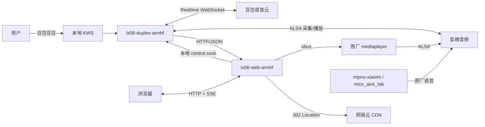

# XiaoAI Sidekick

> 大模型驱动的小爱音箱副驾<br>
> An on-device sidecar for the Xiaomi XiaoAI Speaker Pro (LX06).

[](#功能状态)
[](#支持的设备)
[](#设计原则)

XiaoAI Sidekick 以 Sidecar 方式运行在音箱内部，保留原厂小爱，并扩展本地唤醒、豆包实时语音、网易云音乐、Web 控制台和模型工具调用。它不依赖额外常开的电脑、NAS 或云端中转服务器；音频与模型请求由音箱直接发出。

> **项目状态：实验性。** 目前只支持和验证了 LX06 + ROM 1.94.13。刷机有风险，完整原厂功能回归与固件恢复尚未验证。请在动手前阅读[安全说明](#安全与隐私)和[已知限制](#已知限制)。

## 目录

- [这是什么](#这是什么)
- [设计原则](#设计原则)
- [功能状态](#功能状态)
- [架构](#架构)
- [支持的设备](#支持的设备)
- [快速开始](#快速开始)
- [使用](#使用)
- [已知限制](#已知限制)
- [安全与隐私](#安全与隐私)
- [仓库结构](#仓库结构)
- [文档](#文档)
- [参与贡献](#参与贡献)
- [许可证](#许可证)
- [致谢](#致谢)

## 这是什么

XiaoAI Sidekick 是一个运行在小爱音箱 Pro（LX06）机内的轻量副驾程序。它不改写原厂语音服务，而是通过音箱已有的 ALSA、ubus 和播放器接口扩展能力：

- 本地检测“豆包豆豆”，唤醒后连接豆包实时语音；
- 在音箱内完成收音、回声消除、灯效、回答播放和连续追问；
- 提供局域网 Web 控制台，管理语音、播放器和网易云账号；
- 把网易云榜单/歌单交给原厂播放器播放，保留原厂解码、切歌和循环能力；
- 通过固定的本地工具接口，让模型调用搜索、歌单、播放控制等能力。

它不是固件替换，也不是把原厂小爱“刷掉”。原厂进程仍然运行；当前设计目标是两者并存。

### English overview

XiaoAI Sidekick is an experimental on-device sidecar for the Xiaomi XiaoAI Speaker Pro (LX06). It keeps the factory assistant and adds a local wake word, Doubao realtime voice, a LAN Web console, and Netease playback without an always-on server.

- Local capture, AEC, wake detection, playback and LED feedback run on the speaker;
- The factory player owns the music queue, decoding, track changes and looping;
- A small Web service exposes fixed JSON actions and a local tool socket;
- Credentials, recordings and device readbacks stay out of Git.

The project is hardware-specific, requires a rooted/patched LX06 (ROM 1.94.13), and is not affiliated with Xiaomi, ByteDance or Netease. See [Known limitations](#已知限制), [Security](SECURITY.md) and [Contributing](CONTRIBUTING.md). No license has been declared yet.

## 设计原则

| 原则 | 含义 |
|---|---|
| 机内优先 | 不依赖常开电脑或外部中转服务；设备自己完成采集、控制和云端连接 |
| 保留原厂 | 原厂小爱、Mesh、米家和播放器继续存在；Sidekick 只扩展旁路能力 |
| 最小权限 | 只暴露固定的 HTTP/JSON 和本地 socket 方法，不提供任意 shell 或原始 ubus 透传 |
| 不转发音频 | 网易云音频由原厂播放器直连 CDN；本机只提供短小的 302 控制响应 |
| 可回滚 | 写入设备前保存旧文件；部署和撤回步骤写入报告与操作日志 |
| 文档可复核 | 区分实测、公开资料和推断；每轮结论附命令、哈希和限制 |

## 功能状态

| 能力 | 状态 | 说明 |
|---|---|---|
| 原厂小爱并存 | 设计目标 | 原厂 `mipns-xiaomi`、`mico_aivs_lab` 保留；完整功能回归未验证 |
| 本地唤醒“豆包豆豆” | 可用，有限 | MFCC + DTW，安静环境可用；音乐播放时误唤醒仍未解决 |
| 豆包实时语音 | 已验证 | 回答、连续追问、超时关闭已验证；回答时打断已实现，真人验证有限；使用会产生云端费用 |
| Web 控制台 | 已验证 | 状态、语音、播放器、灯效、网易云登录与歌单 |
| 网易云登录/搜索/榜单 | 已验证 | 扫码登录、会话保存与恢复、账号授权音源 |
| 网易云歌单队列 | 已验证 | 上限 600 首；538 首歌单实测完整入队，原厂播放器循环 |
| 本地 302 直链刷新 | 已验证 | 队列保存本机 URL，播放时现场签发 CDN 地址，避免直链过期 |
| 原厂播放器循环 | 已验证 | 正确模式是 `SEQUENCE`；`LoopSequence` 会在末尾停止 |
| 工具注册表 / 模型工具 | 已验证，部分 | 固定工具注册表；搜索、歌单和播放控制可用；米家设备控制尚未接入 |
| 音频采集与 AEC | 已接入 | 6 路麦克风 + 2 路播放参考，Speex AEC；音乐下误唤醒仍需继续处理 |
| 米家/红外控制 | 未实现 | 预留在工具命名空间中，未完成设备验证 |
| 超过 600 首自动续装 | 未实现 | 长歌单会截断到 600 首 |

更细的逐轮证据见[报告目录](.agents/notes/reports/)和[操作日志](logs/operations.md)。

## 架构



主要进程：

| 进程 | 作用 |
|---|---|
| `lx06-web-armhf` | Web 控制台、JSON API、网易云 provider、本地 302 解析、工具注册表 |
| `lx06-duplex-armhf` | ALSA 采集、AEC、唤醒、豆包实时会话、回答播放、灯效 |
| `mediaplayer` | 原厂播放器；拥有队列、解码、切歌、循环和进度 |
| `mipns-xiaomi` / `mico_aivs_lab` | 原厂语音与云端服务，保持运行 |

Sidekick 只保存曲目元信息和最多 600 个本机 URL，不保存歌曲文件，也不代理音频流。

## 支持的设备

| 项目 | 要求 |
|---|---|
| 型号 | 小爱音箱 Pro，LX06 |
| 固件 | 1.94.13（实测） |
| SSH | 由上游 `open-xiaoai` 补丁开启；本仓库不提供完整刷机镜像 |
| 内存 | 设备可见约 128 MiB；实际 Web/语音进程需按报告中的 RSS 预算 |
| 其他型号 | 未验证，不建议直接使用 |

刷机与 SSH 补丁的上游来源、SHA256 和恢复边界见[ROM 与复现材料](rom/README.md)和[SSH 说明](.agents/notes/reference/ssh.md)。

> 当前补丁关闭了 OTA。原厂完整功能回归和固件恢复尚未验证；请不要把“SSH 可登录”当成“所有原厂功能已验证”。

## 快速开始

这不是一键安装器。开始前请先阅读[部署范围](.agents/notes/reference/web-deploy-scope.md)、[操作日志](logs/operations.md)和上游刷机说明，并在自己的设备上完成分区备份。

### 1. 刷入 SSH 补丁

按[ROM 与复现材料](rom/README.md)获取与 1.94.13 对应的 squashfs，按上游 `open-xiaoai` 流程写入 `system0`，保留 `boot0`、`boot1` 和 `system1`。不要刷写来源不明的镜像。

完成后通过 SSH 确认：

```sh
cat /usr/share/mico/version
uname -srm
```

应看到 LX06 / 1.94.13 和 ARM Linux 内核。设备地址以你的局域网为准，下面的 `<speaker-ip>` 需要替换。

### 2. 准备构建环境

仓库内的构建脚本以 Windows PowerShell 为主，使用 Zig 0.13 交叉编译 ARM/glibc，并链接设备自带 glibc 2.25。工具链恢复、脚本分类和路径约定见[tools/README.md](tools/README.md)。

```powershell
# Web 控制台
powershell -NoProfile -File tools/Build-NativeGlibc.ps1 -Web

# 机内语音客户端
powershell -NoProfile -File tools/Build-NativeGlibc.ps1 -Duplex
```

产物在 `build/`：`lx06-web-armhf`、`lx06-duplex-armhf`。构建后会执行 ELF 架构和依赖检查。脚本默认使用 Windows 开发目录；如路径不同，传入 `-ProjectDir <repo>`。

macOS/Linux 也可以使用 Zig 0.13 交叉编译，但当前仓库没有打包好的 macOS 脚本；需要准备 curl 7.55.1 头文件、设备 `libc-2.25.so` / `libdl-2.25.so`，并按 `tools/Build-NativeGlibc.ps1` 的参数链接。不要把未经验证的二进制直接部署到设备。

### 3. 部署 Web 控制台

```powershell
powershell -NoProfile -File tools/Manage-LX06Web.ps1 -Install -Start
```

如果脚本默认路径与你的仓库不同，同样传入 `-ProjectDir <repo>`。打开：

```text
http://<speaker-ip>:18080/
```

Web 只监听局域网；写操作需要页面会话中的 CSRF token 和同源 Origin。控制协议见[control-protocol.md](.agents/notes/reference/control-protocol.md)。

### 4. 配置语音

把豆包实时语音 Key 放到 `private/credentials.json`（权限 0600，`.gitignore` 已排除），或在启动时通过受保护的 stdin/FIFO 传入。Key 不应出现在命令行参数、日志、截图或 Issue 中。

```json
{
  "realtime": {
    "api_key": "<your-key>"
  }
}
```

然后在 Web 控制台启动语音，或使用设备上的 `deploy/start.sh`。默认没有开机自启；重启后需要重新提供 Key。

### 5. 登录网易云

在 Web 控制台点击网易云登录，用网易云 App 扫码。登录会话保存在设备自有目录，权限 0600；退出登录会清除。随后可以搜索、浏览榜单、读取账号歌单并把队列交给原厂播放器。

## 使用

### Web 控制台

- 查看设备、语音、播放器、灯效和网易云状态；
- 启动/停止语音，查看会话阶段；
- 暂停、继续、停止、上一首、下一首；
- 浏览网易云榜单和账号歌单，播放前 600 首；
- 管理网易云登录和会话。

### 语音

说“豆包豆豆”进入本地唤醒；唤醒后连接豆包实时语音。回答结束或超时后回到待机。音乐播放时原厂播放器与 Sidekick 共用音频设备，AEC 用于降低回声，但误唤醒仍是当前主要未解决问题。

### 本地 API

- `POST /api/v1/command`：页面与外部适配器共用的固定命令；
- `GET /api/v1/state`：状态快照；
- `GET /api/v1/events`：SSE 状态事件；
- `/data/lx06-agent/control.sock`：仅本机工具调用，不对外开放。

详细字段、错误码和权限边界见[控制协议](.agents/notes/reference/control-protocol.md)。

## 已知限制

| 限制 | 影响 |
|---|---|
| 音乐下误唤醒未解决 | 无人呼叫时仍可能自激活；不能把短时测试当作验收通过 |
| 歌单上限 600 首 | 更长的歌单会截断；8428 首歌单需要分批详情管线，当前未实现 |
| 单曲播放仍走即时直链 | 本次 302 刷新覆盖榜单/歌单队列；单曲接口尚未统一 |
| 无开机自启 | 设备重启后需要重新启动 Web/语音并提供 Key |
| OTA 已关闭 | 不能依赖官方 OTA；恢复与回滚需要手动操作 |
| 原厂完整回归未完成 | 米家、Mesh、闹钟、蓝牙、红外等功能需要逐项回归 |
| 只验证 LX06 / 1.94.13 | 其他型号和固件版本没有保证 |
| 依赖云端服务 | 豆包语音会产生费用；网络不可用时语音不可用 |

## 安全与隐私

- 本项目会修改音箱固件并安装 root 权限程序。刷机、分区写入和 SSH 补丁都有变砖风险；请先备份，并确认你能恢复。
- 不要提交或公开：豆包 API Key、网易云 Cookie/`MUSIC_U`、SSH 密码、设备分区回读、个人录音、局域网地址之外的设备标识。
- 只播放账号有权播放的音源；不提供 DRM 绕过、试听解锁或第三方音源规避。
- Web API 只允许固定动作；本地工具 socket 权限为 0600。不要把端口暴露到公网。
- 发现安全问题请按[SECURITY.md](SECURITY.md)私下报告，不要在公开 Issue 中贴密钥或完整日志。

## 仓库结构

```text
src/                   机内 C 程序、协议、音频、Web 和工具实现
web/                   Web 控制台静态资源
tools/                 构建、部署、诊断、逆向和检查脚本
deploy/                设备端启动/停止/状态脚本
rom/                   公开固件来源、校验值与复现说明
private/               凭据、录音、设备回读和运行时快照（不入库）
temp/                  解包根文件系统、逆向产物、模型分析（可重算）
vendor/                本地工具链与第三方依赖（不入库）
logs/operations.md     按时间顺序的实际操作记录
.agents/notes/         架构、协议、参考文档与逐轮报告
```

`private/`、`vendor/`、`temp/`、`build/` 以及固件二进制默认不进入 Git；不要为了“方便复现”把设备特定数据提交上去。

## 文档

| 文档 | 内容 |
|---|---|
| [项目上下文](.agents/notes/reference/context.md) | 当前状态、关键决策和接续入口 |
| [控制协议](.agents/notes/reference/control-protocol.md) | Web API、状态、事件、工具和权限 |
| [实时语音客户端](.agents/notes/reference/realtime-client.md) | 豆包 Realtime 协议、音频格式和会话预算 |
| [音频与回声消除](.agents/notes/reference/audio-pipeline.md) | ALSA 拓扑、6 麦 + 2 参考、Speex AEC |
| [唤醒词检测](.agents/notes/reference/kws.md) | 本地 KWS 参数、阈值和现场限制 |
| [部署与恢复](.agents/notes/reference/deploy-revision14.md) | 历史部署范围、回滚文件和边界 |
| [操作日志](logs/operations.md) | 每次实际改动、测试结果和清理情况 |
| [报告目录](.agents/notes/reports/) | 逐轮证据；从分析到实机验证 |
| [知识索引](.agents/notes/reference/knowledge.md) | 参考文档与报告索引 |
| [研究来源](.agents/notes/reference/sources.md) | 公开资料、上游项目和许可说明 |

## 参与贡献

欢迎提交问题、文档修正、设备兼容性报告和小范围补丁。开始前请阅读[CONTRIBUTING.md](CONTRIBUTING.md)。

特别需要：

- LX06 以外型号的只读兼容性调查；
- 音乐下误唤醒的负样本与可复现实验；
- 米家/红外控制的安全接口设计；
- 长歌单的 `trackIds` / 分批详情方案；
- 可重复的构建与回归脚本。

请把“实测输出、公开资料、推断”分开写；修改设备状态前说明备份和回滚方案。不要在 PR 中包含密钥、Cookie、个人录音或设备分区镜像。

## 许可证

本仓库目前**没有 `LICENSE` 文件**，因此尚未授予再分发或商用许可。把它作为开源项目发布前，维护者需要选择并加入许可证（例如 MIT、Apache-2.0 或其他）。固件、上游补丁和第三方依赖的版权/许可分别归其原作者，详见[研究来源](.agents/notes/reference/sources.md)和[rom/README.md](rom/README.md)。

## 致谢

- [open-xiaoai](https://github.com/idootop/open-xiaoai)：LX06 SSH 补丁与早期社区研究；
- 小米小爱音箱原厂固件与硬件；
- 豆包实时语音、网易云音乐接口及其公开文档；
- 所有提交现场日志、负样本和回归结果的贡献者。

---

如果这个项目对你有帮助，欢迎先读[项目上下文](.agents/notes/reference/context.md)，再从一个小而可验证的改动开始。
