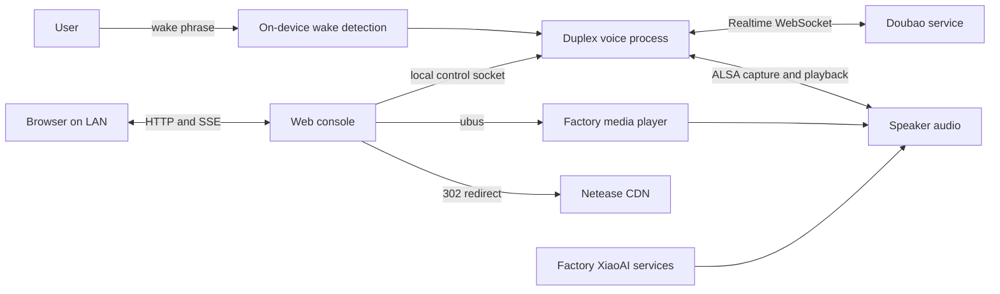

# XiaoAI Sidekick

**An experimental on-device voice assistant extension for the Xiaomi XiaoAI Speaker Pro (LX06).** It keeps the factory assistant and adds a local wake-word path, Doubao real-time voice, music controls, and a LAN web console.

> **Status:** experimental. The project has been exercised on an LX06 running firmware 1.94.13. It is not a general firmware builder or a one-click installer. The wake model still needs broader validation, especially while music is playing. Read the [device and recovery limits](#device-and-recovery-limits) before changing a speaker.

本项目面向希望在 LX06 音箱上扩展本地语音交互的开发者。程序以 root sidecar 方式运行，使用音箱现有的 ALSA、ubus 和播放器接口；当前目标是保留原厂小爱、米家、Mesh 与播放器服务。

## What it does

- Runs wake-word detection and audio capture on the speaker.
- Connects to Doubao real-time voice after a wake event when credentials are configured.
- Provides a LAN web console for voice, playback, lighting, and Netease account controls.
- Uses the factory media player for music queue, decoding, track changes, and looping.
- Exposes a fixed set of local and HTTP actions; it does not expose a general-purpose shell API.

语音请求会连接第三方服务并可能产生费用。网易云能力依赖账号权限和第三方接口。米家设备控制尚未接入。

## Current state

| Area | Current state | Boundary |
|---|---|---|
| Device | Tested on XiaoAI Speaker Pro LX06, firmware 1.94.13 | Other models and firmware versions are unverified |
| Factory assistant | Factory processes are intended to remain installed and running | Full factory feature regression has not been completed |
| Wake word | A custom two-stage model can be loaded by the local wake path | Recall and false activations need more real-device evaluation; music remains difficult |
| Doubao voice | Real-time sessions and local no-credential acknowledgement have been exercised | Requires network and configured credentials for cloud voice |
| Web console | LAN console controls voice and factory playback | No authentication beyond the documented local-network/session protections; do not expose publicly |
| Netease playback | Login, charts, playlists, and factory-player queue have been exercised | Queue limit is 600 tracks; not every playback path uses URL refresh |
| Firmware image | No complete, reproducible image build and recovery workflow is provided | Building the application is distinct from rebuilding and flashing a full firmware image |

See [the reference guide](.agents/notes/reference/knowledge.md) for current technical topics and [reports](.agents/notes/reports/) for evidence and test limits.

## Architecture

The duplex process captures audio, performs echo cancellation and wake detection, then manages the real-time voice session. The web process serves the console and fixed control methods. The factory player owns its playback queue and audio decoding. This diagram describes the intended/current integration; it does not imply that every factory feature has passed regression testing.

## Device and recovery limits

- The only tested target is the LX06 on firmware 1.94.13 with the community SSH patch.
- The repository does not contain a complete flashable firmware image or a verified end-to-end restore procedure.
- The patch disables OTA. A failed flash or root-level change may make the device unusable.
- Root access does not prove that factory voice, Mi Home, Mesh, alarms, Bluetooth, infrared, and playback all work correctly.
- The project does not start services automatically at boot by default.

Do not flash an image or write a partition based only on a successful build. Before any device write, prepare a device-specific backup and recovery plan, verify the image and target partition, and record a read-back hash. Follow the upstream device-specific instructions referenced by [ROM materials](rom/README.md). This repository's historical reports are evidence of past experiments, not a substitute for a current recovery plan.

## Build and install status

The source includes native C programs, web assets, and build/deployment scripts. The documented primary build path currently uses Windows PowerShell and Zig 0.13; some scripts expect local toolchain files that are intentionally not committed. macOS/Linux setup is not yet a clean-clone workflow. The repository does **not** currently let a new user build a complete firmware image and safely install it from source alone.

For the existing application build commands and their prerequisites, see [tools/README.md](tools/README.md). Do not treat an application binary build as a firmware image build. Installation is device-specific and should only be attempted after the recovery plan described above is ready.

## Wake-model training

The repository contains experimental training and model-format tools under `tools/`, plus the baseline v5 two-stage acoustic model files under `models/wake-doubao-v5/`. A later device configuration adjusted the decoding graph without changing the acoustic networks; the exact adjusted model containers are not checked in. The checked-in files make the baseline weights available, but do not include private recordings or a complete ready-to-run training environment. The [model card](models/wake-doubao-v5/README.md) records checksums, intended use, and evaluation limits.

Training currently depends on locally supplied recordings, generated speech/audio-recognition assets, and factory-format templates extracted from a compatible device image. The scripts and data preparation steps still have local-environment assumptions. A user can study and extend the training pipeline, but a clean-clone, end-to-end custom training workflow is not yet established. See the [wake-model primer](.agents/notes/reference/wake-model-primer.md), [training workflow and prerequisites](.agents/notes/reference/wake-model-training.md), and [privacy guidance](SECURITY.md).

Never publish personal recordings, recognition transcripts containing personal data, credentials, device dumps, or private training labels without explicit consent and a review of redistribution rights.

## Repository map

| Path | Contents |
|---|---|
| `src/` | Speaker-side native programs and interfaces |
| `web/` | Web console assets |
| `tools/` | Build, deployment, diagnostics, and wake-model tooling |
| `deploy/` | Speaker-side start, stop, and status scripts |
| `models/` | Versioned model artifacts intended for distribution |
| `rom/` | Public source references and ROM reproduction notes; not a complete flash image |
| `.agents/notes/reference/` | Maintained technical references and current guidance |
| `.agents/notes/reports/` | Evidence from experiments and device operations |
| `.agents/notes/implemented/`, `proposed/`, `rejected/`, `archived/` | Decision records governed by Agent Notes |
| `logs/operations.md` | Chronological operation record |
| `private/`, `vendor/`, `temp/`, `build/` | Local/private inputs, dependencies, generated files, and build outputs; not published |

## Documentation

- [Agent Notes conventions](.agents/notes/README.md) — decision records, references, reports, and validation rules.
- [Curated reference guide](.agents/notes/reference/knowledge.md) — maintained technical topics.
- [Deployment and recovery](.agents/notes/reference/deployment-and-recovery.md) — device write boundaries and current rollback rules.
- [Tools and build notes](tools/README.md) — local prerequisites and script entry points.
- [Contributing](CONTRIBUTING.md) — contribution scope and review expectations.
- [Security](SECURITY.md) — sensitive data and vulnerability reporting.
- [ROM materials](rom/README.md) — upstream references and recovery boundaries.

## License

There is no `LICENSE` file in this repository. Until the maintainers add one, the repository does not grant permission to redistribute or use its contents under an open-source license. Third-party firmware and dependencies retain their own terms.
